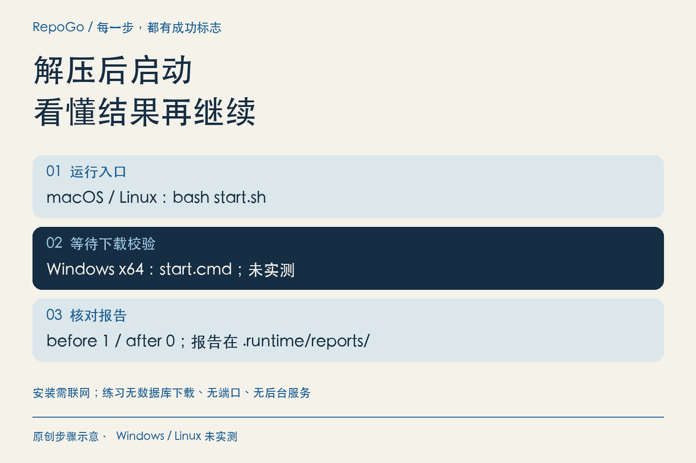

# 安装、运行与结果核验

## 1. 确认环境和边界

本期固定 Trivy v0.76.1。Trivy 是 Aqua Security 维护的安全检查工具；本期只做其中“文件内凭据检查”的假数据练习，不做漏洞、容器或云资源检查。

| 系统 | 本期入口 | 验证情况 |
|---|---|---|
| macOS Apple Silicon | `bash start.sh` / `start.command` | 官方包完整下载、校验、启动入口扫描与复扫均已实测；双击窗口未测 |
| macOS Intel | `bash start.sh` | 官方包和下载校验值已整理，未实测 |
| Linux x64 / arm64 | `bash start.sh` | 官方包和入口已整理，未实测；不包含32位Linux |
| Windows x64 | `start.cmd` / `start.ps1` | 官方包和入口已整理，未实测 |
| Windows ARM64 | 无原生入口 | 本期不承诺支持 |

macOS/Linux 依赖 Bash、curl、tar、Python 3.9+；Windows x64 依赖 PowerShell 5.1+。不需要 Docker、GPU、付费模型、账号或管理员权限。没有监听端口，不用打开网页。下载需要网络；本次假样例练习使用离线扫描选项，不下载漏洞数据库。不要把它等同于所有 Trivy 功能都能离线使用。

## 2. 运行入口

解压后在文件夹内打开终端：

```bash
bash start.sh
```

Windows 可双击 `start.cmd`；也可在 PowerShell 中进入该目录后运行 `./start.ps1`。策略拦截时不添加 Bypass，不改执行策略，见 FAQ。

入口选择当前架构的官方 v0.76.1 发行包，下载到 `.runtime/downloads/`，每次核对固定 SHA-256，再仅提取 `trivy` / `trivy.exe`。下载失败就停止，不换成来源不明的镜像。

## 3. 看懂练习

`samples/before.txt` 里是无效假标记：

```text
REPOGO_DEMO_TOKEN=REPOGO_PRACTICE_ONLY_1234567890
```

`practice-secret.yaml` 是规则文件：告诉工具寻找 `REPOGO_PRACTICE_ONLY_` 后接十位数字的内容。它是为理解流程设计的自定义规则，不是真实供应商令牌格式。

入口把 before 和 after 两份样例分别复制到 `.runtime/practice-before/` 与 `.runtime/practice-after/`，只扫描这两个文件夹，不扫描工作区或家目录。after 是另一个无效占位文本 `READ_FROM_ENV_AT_RUNTIME`；这只是“不要把敏感值写进文件”的演示，没有实现真实环境变量注入。

核心命令（macOS/Linux，入口会自动执行）：

```bash
.runtime/bin/trivy --cache-dir .runtime/cache fs \
  --scanners secret --skip-version-check --disable-telemetry --offline-scan \
  --secret-config practice-secret.yaml --format json --exit-code 1 \
  --output .runtime/reports/before.json .runtime/practice-before
```

`fs` 表示扫描指定文件夹；`secret` 表示只检查凭据；JSON 是方便程序读取的报告格式；`--exit-code 1` 表示命中时返回 1。此时 1 是练习预期，不是安装失败。入口会再扫 after 并检查退出码与发现数量。



## 4. 成功标志和报告

before：发现 1 项、规则 `repogo-demo-only`、退出码 1。

after：发现 0 项、退出码 0。

总入口：完成检查后返回 0；任何数量、规则或退出码不符会停止并返回失败。报告在 `.runtime/reports/before.json`、`after.json`、`summary.json`。原始报告可能包含本地绝对路径与被扫描文本，不要整份公开上传；本练习仅含假数据。

## 5. 停止、重跑、数据与升级

扫描结束进程自动退出，没有后台服务。运行中可 Ctrl+C 停止；再次运行相同入口会重扫附带样例，不改动原始样例，不自动扫描用户项目。不要同时运行多个入口，以免写同一组报告。

所有下载、二进制、缓存和报告只在本目录 `.runtime/`，已被 Git 忽略。备份原创样例/规则及需要留存的报告；它们不是会员附件的一部分。想重置练习可将整个 `.runtime` 文件夹先移动到别处备份后重新启动，不删除用户其他目录。

升级时单独建立新文件夹，核查上游 release、许可和校验值，再验证，不直接修改版本号跳过校验。固定版本不表示长期最新或永久安全。

## 6. 如果以后发现真实泄漏

先到对应服务撤销/轮换凭据，核查是否被使用，再按团队流程清理 Git 历史和其他副本。只删当前文件里的字符串不代表历史泄漏已解决。真实项目扫描应由所有者明确选定目录、检查排除规则和本地配置；本入口故意不提供自动全盘扫描。
