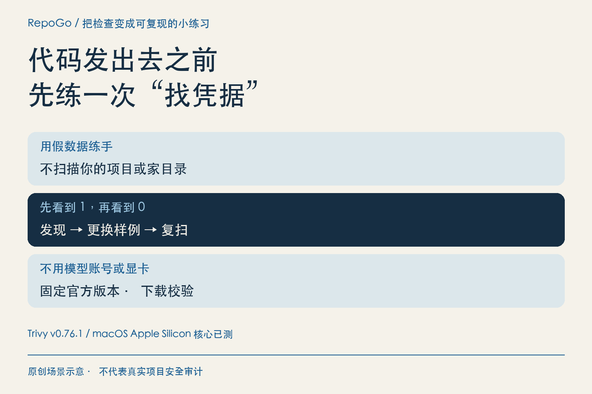
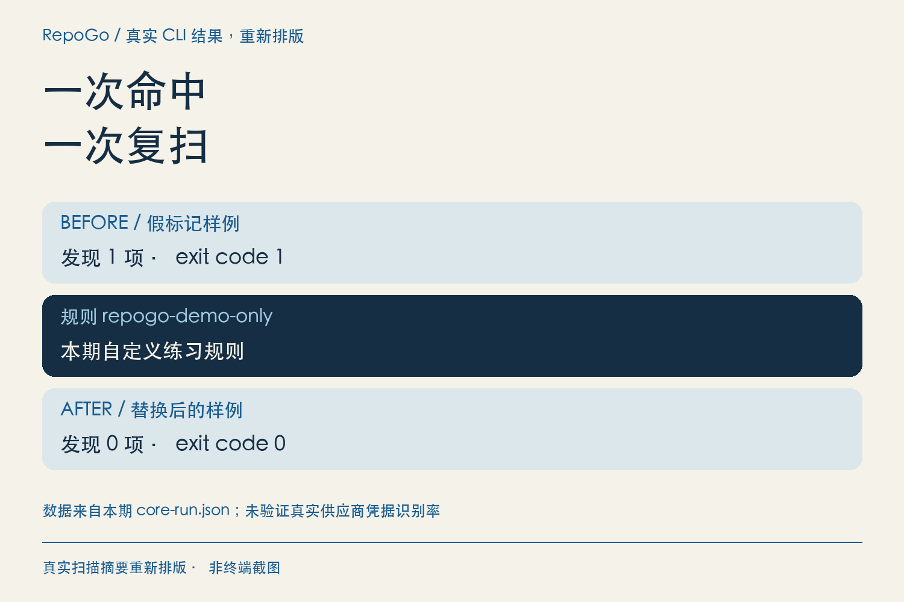

# 提交前，先练习检查文件里的凭据

这是 RepoGo 为 [Trivy](https://github.com/aquasecurity/trivy) v0.76.1 编写的中文练习包装，不是原项目，也不是完整界面汉化。凭据是程序访问服务时用的密码或令牌；这次全部使用无效假数据。

我们在 macOS Apple Silicon 实跑了交付入口：分别扫描两份预置假样例，before 命中 1 项，after 不含假标记、发现 0 项。入口不会自动修改你的代码，也没有实现真实环境变量注入。这个对照证明自定义练习规则、报告和退出码流程可用，不证明能够发现所有真实泄漏。

## 从这里开始

先完整解压到自己的普通文件夹。macOS/Linux 需要 Bash、curl、tar、Python 3.9+；Python 仅解析本地报告，不装第三方库。Windows x64 使用系统 PowerShell 5.1 或更新版本，无需 Python。首次启动要能访问 GitHub 官方发行页，约 50 MB，实际大小随系统包变化。

- macOS：终端进入此文件夹，运行 `bash start.sh`。也提供 `start.command` 双击入口；系统若阻拦，先看 [FAQ](FAQ.md)，不关闭安全防护。
- Linux x64/arm64：终端进入此文件夹，运行 `bash start.sh`。
- Windows x64：双击 `start.cmd`。如果组织策略阻止 PowerShell，请停止并使用官方安装说明，或联系本机管理员；脚本不修改执行策略。

成功输出应含 `before: 发现 1 项 / 退出码 1` 和 `after: 发现 0 项 / 退出码 0`，最后“练习通过”。Windows 格式略有空格差异。

详细步骤见 [DEPLOY.md](DEPLOY.md)，常见问题见 [FAQ.md](FAQ.md)，来源见 [ATTRIBUTION.md](ATTRIBUTION.md)，服务范围见 [SERVICE.md](SERVICE.md)。

## 包里有什么

原创中文文档、跨系统启动入口、两个无效假样例、自定义练习规则和原创图解。程序运行时从上游固定官方版本下载并做 SHA-256 校验（校验下载文件是否与预期一致）。不含上游程序、源码、真实凭据、运行日志或用户数据。

上游原地址：https://github.com/aquasecurity/trivy

RepoGo 公开交付仓库：https://gitee.com/lushengjie/repogo-trivy 。该仓库已于 2026-10-30 公开；星球附件也可独立解压使用。
